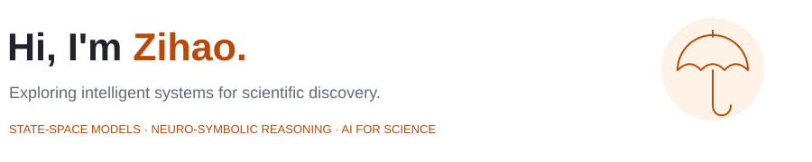
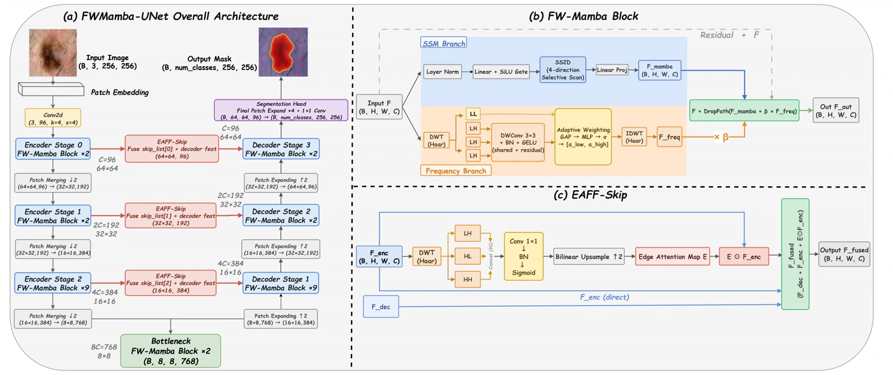
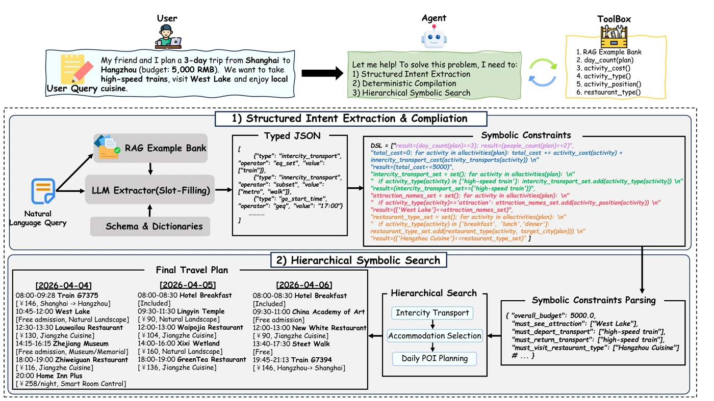
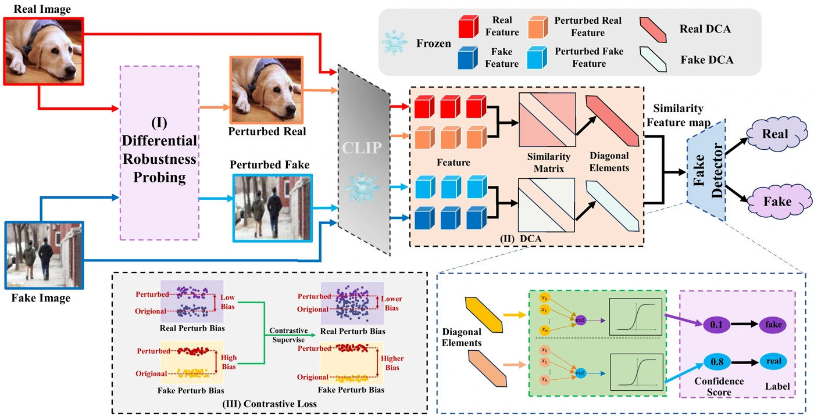
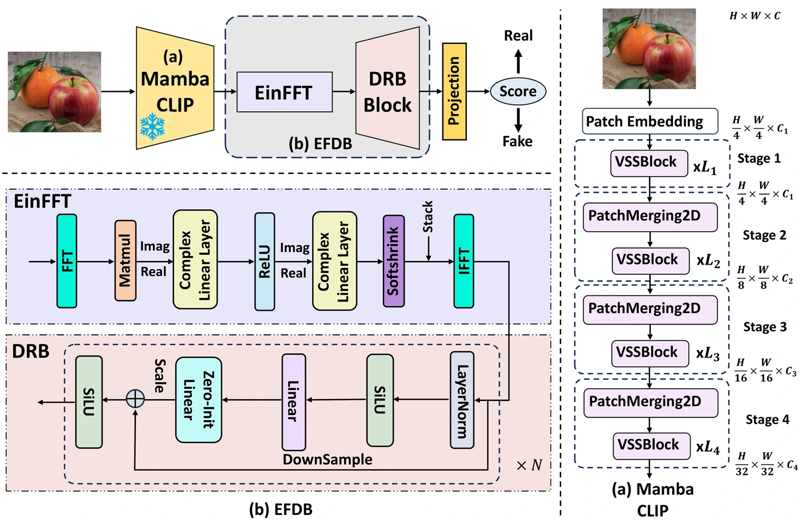

<a href="https://unumbrela.github.io/">
<picture>
  <source media="(prefers-color-scheme: dark)" srcset="assets/img/profile-header-dark.svg">
  
</picture>
</a>

**[Visit my personal website ↗](https://unumbrela.github.io/)** · Research, publications & projects

**English** · [简体中文](README_CN.md)

**Incoming direct-entry PhD @ USTC** · Expected Sep 2027 School of Artificial Intelligence and Data Science 
**Undergraduate @ Jiangnan University** · 2023–2027 School of Artificial Intelligence and Computer Science

[Homepage ↗](https://unumbrela.github.io/) &nbsp; · &nbsp; [Google Scholar ↗](https://scholar.google.com/citations?user=AWn-jWwAAAAJ) &nbsp; · &nbsp; [Email ↗](mailto:zihao3351@gmail.com) &nbsp; · &nbsp; [WeChat](https://unumbrela.github.io/#wechat-contact) &nbsp; · &nbsp; [QQ](https://unumbrela.github.io/#qq-contact)

I’m **Zihao Guo (郭子豪)**. My work spans state-space modeling, neuro-symbolic planning, and scientific machine learning. Looking ahead, I’m interested in **LLMs and agents for scientific computing**.

## Research

### State-space models

[**FWMamba-UNet**](https://link.springer.com/chapter/10.1007/978-981-92-3429-5_39) 
Frequency-Wavelet Enhanced Mamba UNet for Medical Image Segmentation 
**ICIC 2026 · Oral** &nbsp; · &nbsp; First author &nbsp; · &nbsp; [Paper ↗](https://link.springer.com/chapter/10.1007/978-981-92-3429-5_39) &nbsp; · &nbsp; [Code ↗](https://github.com/unumbrela/FWMamba-UNet)

<a href="https://raw.githubusercontent.com/unumbrela/unumbrela/main/assets/img/fwmamba.webp">Open full-resolution figure ↗</a>

### Neuro-symbolic reasoning

[**Extract-Then-Compile**](https://link.springer.com/chapter/10.1007/978-981-92-3417-2_46) 
Reliable Neuro-Symbolic Planning for Large Language Models 
**ICIC 2026 · Oral** &nbsp; · &nbsp; First author &nbsp; · &nbsp; [Paper ↗](https://link.springer.com/chapter/10.1007/978-981-92-3417-2_46) &nbsp; · &nbsp; [Code · coming soon ↗](https://github.com/unumbrela/ETC-SHINE)

<a href="https://raw.githubusercontent.com/unumbrela/unumbrela/main/assets/img/Extract.webp">Open full-resolution figure ↗</a>

### AIGC detection

[**RA-Det**](https://proceedings.mlr.press/v306/wang26ad.html) 
Towards Universal Detection of AI-Generated Images via Robustness Asymmetry 
**ICML 2026** &nbsp; · &nbsp; Fifth author &nbsp; · &nbsp; [Paper ↗](https://proceedings.mlr.press/v306/wang26ad.html) &nbsp; · &nbsp; [arXiv ↗](https://arxiv.org/abs/2603.01544)

<a href="https://raw.githubusercontent.com/unumbrela/unumbrela/main/assets/img/ICML-framework-1.webp">Open full-resolution figure ↗</a>

[**MambaGuard**](https://link.springer.com/chapter/10.1007/978-981-95-5699-1_25) 
A CLIP-Mamba Approach for OOD Generated Image Detection 
**PRCV 2025** &nbsp; · &nbsp; Co-first author &nbsp; · &nbsp; [Paper ↗](https://link.springer.com/chapter/10.1007/978-981-95-5699-1_25) &nbsp; · &nbsp; [Code ↗](https://github.com/orangecc7/MambaGuard)

<a href="https://raw.githubusercontent.com/unumbrela/unumbrela/main/assets/img/prcv-framework-1.webp">Open full-resolution figure ↗</a>

## Projects

**AMP-Forge** · De novo antimicrobial peptide design 
**iGEM 2025 · Gold Medal** &nbsp; · &nbsp; Dry-Lab Lead

Independently built a design platform connecting protein language models, a VAE, and latent diffusion with activity prediction for closed-loop screening.

- **25,622 peptides** curated from **6 databases**; predictor **PCC = 0.90**.
- Multiple generated variants outperformed the original sequence in wet-lab validation.

[Project details ↗](https://unumbrela.github.io/#projects) &nbsp; · &nbsp; [Code ↗](https://github.com/unumbrela/AMP-Forge)

## Methods & tools

`State-space models` &nbsp; `Neuro-symbolic planning` &nbsp; `Protein language models` &nbsp; `Latent diffusion` &nbsp; `PyTorch`

Open to research conversations on reliable reasoning, scientific agents, and AI for Science. [Get in touch ↗](mailto:zihao3351@gmail.com)
